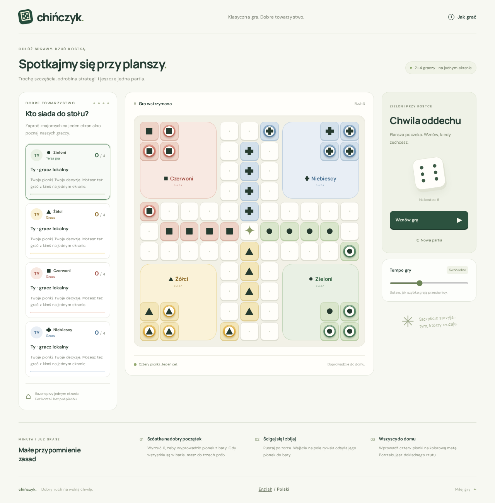
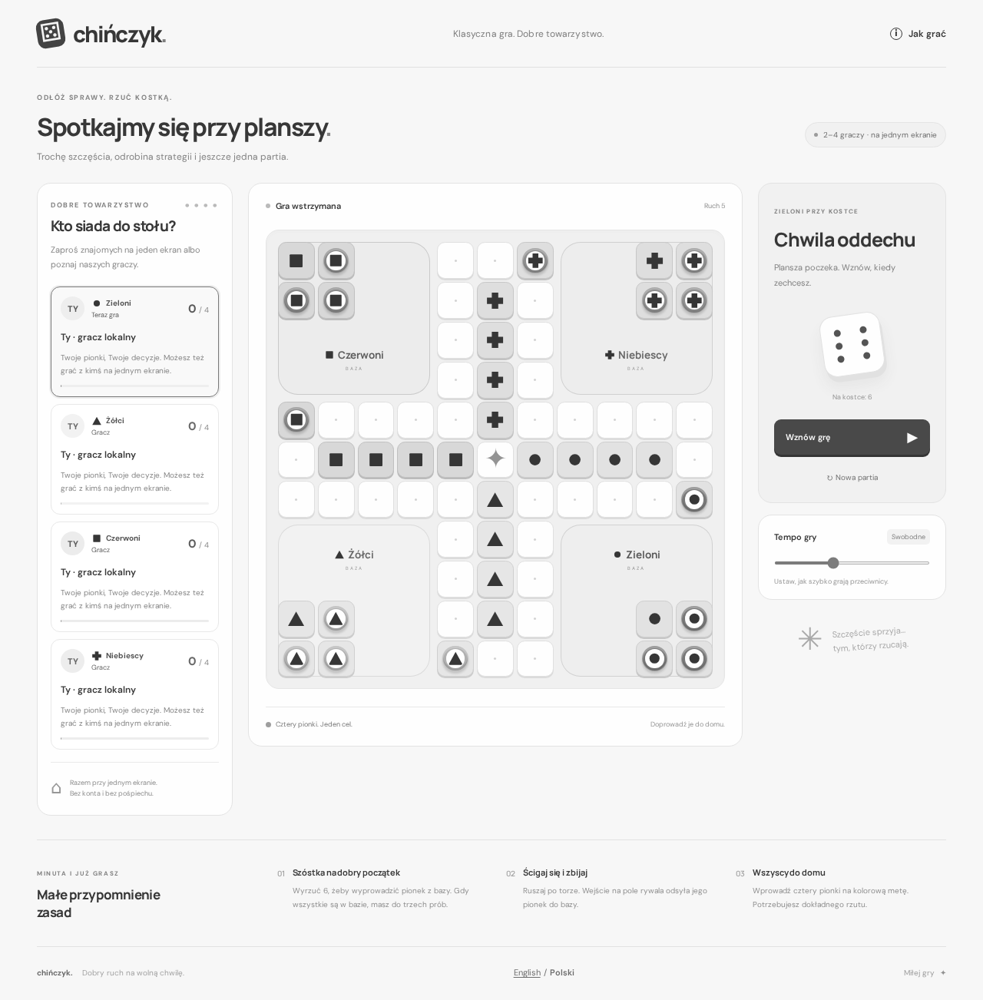
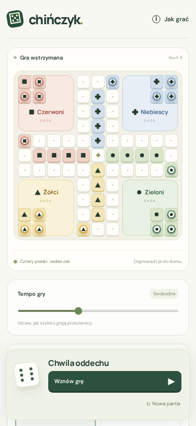
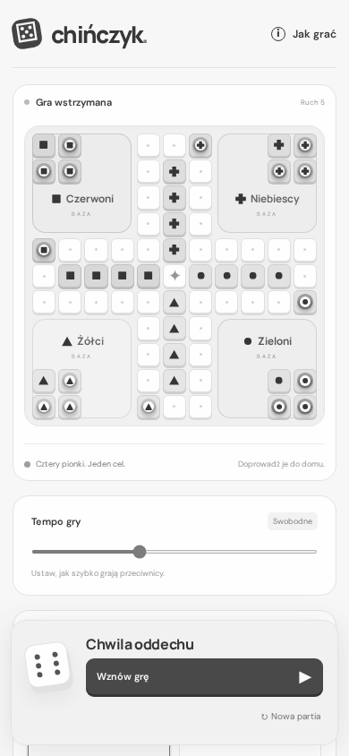

# Player symbols: browser verification

Verified 2026-10-29 UTC, Chromium 156.0.8078.4, application code commit
`5d76a3d582ecf2f2e6c79becbf632fbcfd4a9720` (based on `dc83575`). The following
synthetic game contains four local players. An isolated browser override
`Math.random = () => .99` produces sixes; each player legally moves one pawn
from the base onto the shared route, then the game is paused for comparison.
No production data or server state is used. The documentation commit containing
these images does not change the application bundle.

Seat identity is fixed: Green circle, Yellow triangle, Red square, Blue cross.
The same SVG appears on pawns, empty base/home fields, base labels and player
cards. An occupied field shows the pawn's identity, without a conflicting field
owner mark. Colored outer pawn rings and AI avatars are retained.

| Check | Result |
| --- | --- |
| 1280 × 1000 desktop | Four local players, start, roll, legal moves with Enter/Space; Tab/Shift+Tab focus; disabled fields remain disabled; all 16 pawn identities retained |
| 390 × 844 phone | Separate `isMobile: true`, `hasTouch: true` context; start/roll/pawn taps for all four players; no horizontal page overflow |
| Human + default AI | All three AIs complete a turn, 16 pawn identities retained |
| Language | PL/EN switch retains the 16 pawn symbols and player choices; existing state-preservation test passes |
| Profiles and home | Regression tests cover changing profile, empty seat, visible legend identity, and an occupied field of each owner, including home |
| Existing game rules | Complete seeded AI match, start/roll/move, pause/resume, empty-seat tests preserved |
| Required checks | 20/20 Vitest tests, TypeScript/Vite production build, high-severity dependency audit pass |

Only the existing light theme is available. Each pair below uses the same state;
the second image adds `html { filter: grayscale(1) !important }`. This is a CSS
browser test, not a physical monochrome panel test, and makes no claim about
1-bit output, dithering or ghosting. The phone images show the actual viewport;
the desktop images include the entire page and the player-card legend.

Measured declared SVG foreground `#263b30` on pawn center `#fffefa` gives
11.89:1 sRGB luminance contrast (12.02:1 after CSS grayscale conversion).
On all four empty colored fields the minimum is 8.44:1 (8.50:1 grayscale).
Measurements exclude antialiasing; the smallest phone pawn-symbol SVG is about
12.19 CSS px. The four geometries remain visibly distinct in the rendered images.
This limited feature verification is not a complete accessibility audit.

## Desktop: color and grayscale

## Phone: color and grayscale

